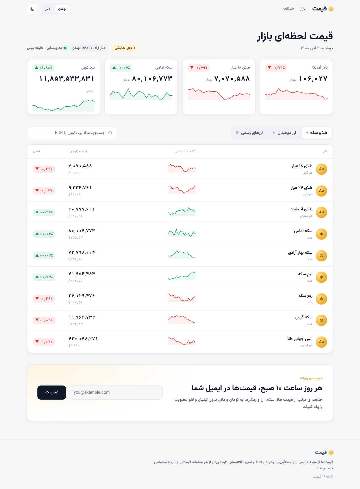
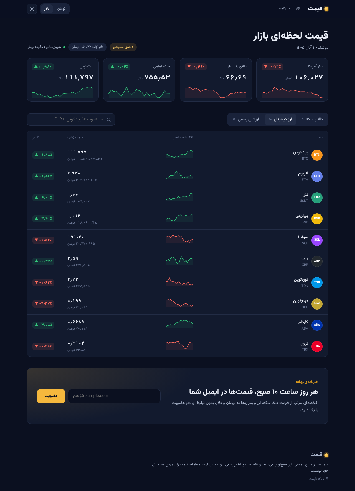
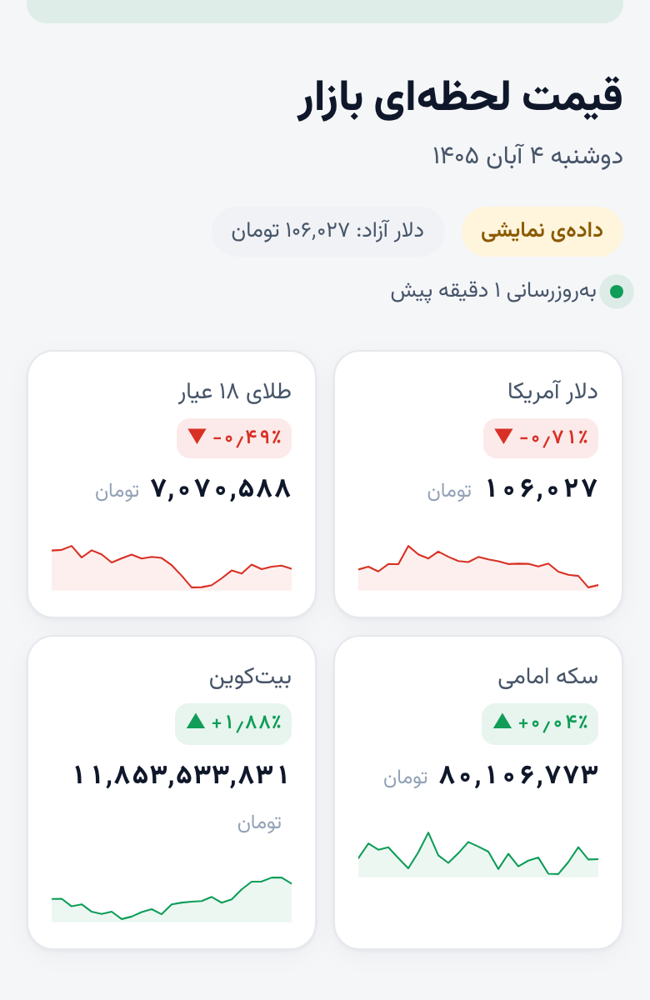
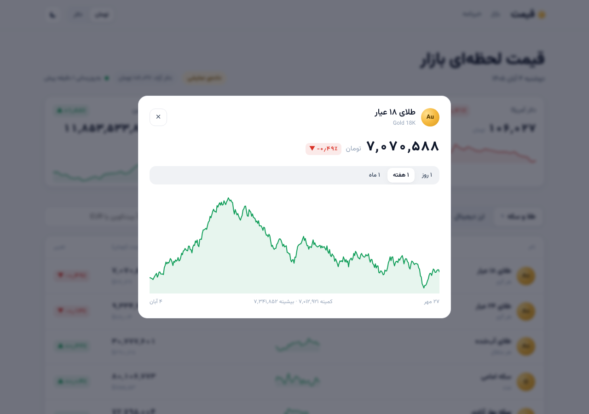
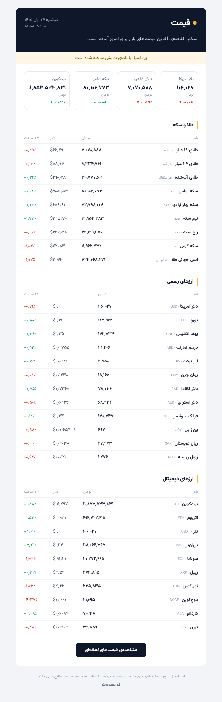

# قیمت (Gheymat)

قیمت لحظه‌ای **طلا و سکه**، **ارزهای دیجیتال** و **ارزهای رسمی** به تومان و دلار، همراه با خبرنامه‌ی روزانه که هر روز **ساعت ۱۰ صبح به وقت تهران** آخرین قیمت‌ها را به ایمیل اعضا می‌فرستد.

| روشن | تیره | موبایل |
|---|---|---|
|  |  |  |

نمودار هر دارایی: 

ایمیل روزانه: 

- **بک‌اند:** Django 5.2 + Django REST Framework، PostgreSQL، Redis، Celery و Celery Beat
- **فرانت‌اند:** React 19 + TypeScript + Vite، TanStack Query، فونت وزیرمتن، راست‌به‌چپ کامل، تم روشن و تیره
- **اجرا:** Docker Compose (nginx جلوی همه‌چیز، یک دامنه و بدون CORS)

## ساختار

```
backend/
  config/        تنظیمات، Celery، آدرس‌ها
  prices/        مدل‌ها، ارائه‌دهنده‌های قیمت، ادغام و ذخیره، API
  newsletter/    عضویت با تأیید دوتایی، لغو عضویت، ارسال روزانه، قالب ایمیل
  tests/         تست‌ها (pytest)
frontend/
  src/components  هدر، کارت‌های شاخص، جدول بازار، نمودار، خبرنامه
  src/lib         API، قالب‌بندی اعداد فارسی، تم
docker-compose.yml
```

## منابع قیمت

| داده | منبع | کلید لازم؟ |
|---|---|---|
| ارزهای دیجیتال (دلاری + تغییر ۲۴ ساعته) | CoinGecko | نه (کلید اختیاری برای سقف بیشتر) |
| نرخ رسمی ارزها نسبت به دلار | open.er-api.com | نه |
| دلار آزاد، طلا، سکه، ارزهای بازار ایران (تومان) | BrsApi.ir **یا** Navasan.tech | **بله** |
| دلار آزاد (پشتیبان) | Nobitex (USDT/IRR) | نه |

**نکته‌ی مهم:** برای بازار ایران API رایگان و رسمی پایداری نیست. لایه‌ی `prices/providers.py` طوری نوشته شده که منبع با یک متغیر (`IRAN_PROVIDER`) عوض شود. نام نمادهای هر منبع در `prices/catalog.py` است. اگر منبع فرمت پاسخش را عوض کرد، همان‌جا اصلاحش کنید. نمادهای BrsApi و Navasan بر اساس مستندات عمومی‌شان نوشته شده‌اند و باید با کلید واقعی یک بار بررسی شوند.

**تبدیل تومان و دلار:** نرخ دلار آزاد پل بین دو واحد است. طلا و سکه به تومان می‌آیند و دلارشان حساب می‌شود. رمزارزها به دلار می‌آیند و تومانشان حساب می‌شود. برای ارزهای رسمی، اگر قیمت بازار ایران موجود باشد همان استفاده می‌شود، وگرنه از نرخ رسمی ضرب در دلار آزاد. اگر یک منبع از کار بیفتد، فقط دارایی‌های همان منبع قیمت قبلی‌شان را نگه می‌دارند.

## اجرای سریع با Docker

```bash
cp .env.example .env        # DJANGO_SECRET_KEY و رمز دیتابیس را عوض کنید
docker compose up --build
```

سایت روی `http://localhost:8080` و پنل مدیریت روی `http://localhost:8080/admin/` بالا می‌آید. برای ساخت کاربر مدیر:

```bash
docker compose exec backend python manage.py createsuperuser
```

با `PRICE_DEMO_MODE=1` (پیش‌فرض در `.env.example`) سایت با داده‌ی نمایشی کار می‌کند و برچسب «داده‌ی نمایشی» نشان می‌دهد. برای داده‌ی واقعی مقدار را `0` کنید و `BRSAPI_KEY` یا `NAVASAN_API_KEY` را بگذارید.

## اجرای محلی برای توسعه

```bash
# بک‌اند
cd backend
python -m venv .venv && . .venv/bin/activate
pip install -r requirements-dev.txt
export DJANGO_DEBUG=1 PRICE_DEMO_MODE=1 CELERY_TASK_ALWAYS_EAGER=1
python manage.py migrate
python manage.py seed_demo          # داده‌ی نمایشی + یک هفته تاریخچه برای نمودارها
python manage.py runserver

# فرانت (ترمینال دیگر)
cd frontend
npm install
npm run dev                          # http://localhost:5173 و /api به جنگو پروکسی می‌شود
```

بدون `POSTGRES_DB` از SQLite و بدون `REDIS_URL` از کش حافظه استفاده می‌شود. برای اجرای زمان‌بندی‌ها به Redis نیاز دارید:

```bash
celery -A config worker -l info
celery -A config beat -l info
```

## خبرنامه

1. کاربر ایمیلش را وارد می‌کند و ایمیل تأیید می‌گیرد (تأیید دوتایی تا ایمیل کسی بی‌اجازه ثبت نشود و ایمیل‌ها به اسپم نروند).
2. بعد از کلیک روی لینک، عضویت فعال می‌شود.
3. Celery Beat هر روز ساعت **۱۰:۰۰ به وقت تهران** `send_daily_newsletter` را اجرا می‌کند. ارسال در دسته‌های ۲۰۰ تایی و با یک اتصال SMTP برای هر دسته انجام می‌شود.
4. اگر زمان‌بند دو بار اجرا شود، به کسی دو ایمیل نمی‌رسد (`last_sent_at` و جدول `Issue`).
5. هر ایمیل لینک لغو عضویت و هدرهای `List-Unsubscribe` (لغو با یک کلیک در Gmail) دارد.

برای ارسال واقعی، در `.env` مقدار `EMAIL_BACKEND` را روی SMTP بگذارید و اطلاعات سرویس ایمیل (مثلاً Amazon SES، Mailgun یا SMTP هاست) را وارد کنید. از پنل مدیریت هم می‌توانید با اکشن «ارسال نمونه‌ی خبرنامه‌ی امروز» یک نمونه برای خودتان بفرستید.

## API

| مسیر | توضیح |
|---|---|
| `GET /api/prices/` | همه‌ی قیمت‌ها گروه‌بندی‌شده (`gold`، `crypto`، `fiat`) با نمودار کوچک ۲۴ ساعته |
| `GET /api/prices/<slug>/history/?days=7` | تاریخچه‌ی یک دارایی (۱ تا ۳۰ روز) |
| `POST /api/newsletter/subscribe/` | `{"email": "..."}` |
| `GET /api/newsletter/confirm/<token>/` | تأیید عضویت |
| `GET/POST /api/newsletter/unsubscribe/<token>/` | لغو عضویت |
| `GET /api/health/` | بررسی سلامت |

## تست

```bash
cd backend && pytest
cd frontend && npm run lint && npm run build
```

## افزودن یک دارایی جدید

یک ردیف به `backend/prices/catalog.py` اضافه کنید (با نماد هر منبع) و `python manage.py migrate` یا `python manage.py sync_assets` را اجرا کنید.
